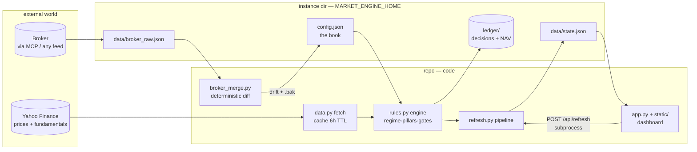

# market-engine — Architecture & Design

**What it is.** A local, rules-based equity decision system: it scores your
stocks and a screener universe on four factor pillars, applies hard risk
gates, turns scores into concrete actions (BUY/ADD/HOLD/TRIM/SELL, or
BUY/WATCH/PASS/AVOID for non-holdings), keeps a self-scoring ledger of every
call versus SPY, and presents it all on a local web dashboard with a
Telegram-ready digest. It is decision support on delayed public data — not a
trading system, not financial advice, and it never places orders.

---

## 1. Design principles

| # | Principle | Consequence |
|---|---|---|
| 1 | **Code and data never mix.** | The repo is 100% shareable; every user's book lives in a private *instance directory*. `engine/paths.py` is the single definition of that boundary. |
| 2 | **The engine is a pure function.** | `portfolio_state(records, config, cash) → state`. No globals, no disk reads for portfolio facts — the same inputs always produce the same decisions. |
| 3 | **Deterministic code owns money; the LLM only fetches.** | Broker sync = agent reads the book via MCP → writes `broker_raw.json` → `broker_merge.py` decides every config change. The model never hand-edits positions or cash. |
| 4 | **Downgrade-only gates.** | Red flags and trend-template failures can only *lower* an action, never raise one. Upside comes from the composite score alone; risk controls are one-directional. |
| 5 | **Evidence before replication.** | Every daily call is snapshotted and later graded vs SPY at 30/60/90d. Nothing is traded on the engine's word until its own ledger supports it. The ledger is never backfilled. |
| 6 | **A long-lived server never imports decision code.** | The dashboard runs refresh as a *subprocess*. (A cached-module bug once made a live server silently rewrite state with stale rules — the architecture now forbids that failure mode.) |
| 7 | **Explain everything.** | Every decision ships with a rule-by-rule trace, flag notes, and flip conditions; the UI is "tap anything for the why." Unexplainable scores are a bug. |
| 8 | **Fail loud, refuse early.** | Missing config → pointed error; wrong broker account → merge aborts; incomplete payloads, implausible book values → abort. Silence is reserved for "nothing changed." |

## 2. The three planes

```
┌────────────────────────────────────────────────────────────────────┐
│  A. THE PRODUCT  (git repo — shareable, portfolio-agnostic)        │
│     engine/ + app.py + static/ + scripts/ + tests/                 │
├────────────────────────────────────────────────────────────────────┤
│  B. THE INSTANCE  ($MARKET_ENGINE_HOME — private, per user)        │
│     config.json · data/ · ledger/                                  │
├────────────────────────────────────────────────────────────────────┤
│  C. THE PLUMBING  (host automation — here: Hermes)                 │
│     crons · broker MCP · watchdog · digest delivery                │
└────────────────────────────────────────────────────────────────────┘
```

Plane A never learns about a book; plane B never contains code; plane C is
replaceable (any scheduler + any broker feed works — plane B's
`broker_raw.json` contract is the seam).

**Resolution rule:** every tool resolves its writable world as
`$MARKET_ENGINE_HOME`, else the current directory. Run from your instance
dir and everything lands there; the repo checkout stays pristine.

## 3. File map

```
market-engine/                      ← plane A: the repo (install with pip install -e)
├── engine/                         decision core, read-only at runtime
│   ├── paths.py                    THE contract: home() = $MARKET_ENGINE_HOME | cwd;
│   │                               config/cache/state/ledger paths all derive here
│   ├── data.py                     yfinance fetch (prices 2y daily + fundamentals),
│   │                               JSON cache, 6h TTL, per-ticker file under data/cache
│   ├── factors.py                  raw metrics → 4 pillar scores (quality, growth,
│   │                               value, momentum; 0–100). Piotroski F-score, 12-1
│   │                               momentum, 8-point trend template, FCF yield, …
│   ├── rules.py                    regime (SPY/QQQ vs 200d + VIX), composite =
│   │                               weighted pillars, action bands, downgrade-only
│   │                               gates, caps, explain/flip traces, portfolio_state()
│   └── ledger.py                   daily decision snapshots + NAV; grades past calls
│                                   vs SPY at 30/60/90d; one entry per calendar day
├── app.py                          Flask dashboard; serves $MARKET_ENGINE_HOME/data/
│                                   state.json; POST /api/refresh → subprocess (rule 6);
│                                   env: DASHBOARD_HOST (127.0.0.1 default), DASHBOARD_PORT
├── static/index.html               the whole UI (single file, no build step): tables,
│                                   sparklines, donut allocator, modals/tooltips driven
│                                   by engine explain fields; renders numbers only from
│                                   state.json — never hardcoded
├── scripts/refresh.py              the pipeline: fetch → score → cost overlay →
│                                   ledger snapshot → sparklines → data/state.json →
│                                   Telegram digest to stdout
├── scripts/broker_merge.py         broker_raw.json → config.json, deterministic.
│                                   Guards: broker_account match, completeness,
│                                   plausible book value. --apply writes .bak first.
├── tests/                          90 pytest tests, offline + synthetic; includes
│                                   subprocess broker-merge cases and Flask API
│                                   traversal defenses; prod-state test self-skips
│                                   without an instance
├── config.example.json             template: strategy params + portfolio shape
├── pyproject.toml                  installable package (engine), deps: yfinance, flask
└── README.md                       user quickstart, broker contract, embedding guide

~/my-book/                          ← plane B: one instance per user (never in git)
├── config.json                     THE BOOK: positions, cost_basis, cash,
│                                   broker_account, baseline_date/_value, weights,
│                                   targets, caps, watchlist, scan_universe, overlay notes
├── data/cache/*.json               price/fundamentals cache (per ticker)
├── data/state.json                 dashboard snapshot — the single artifact the UI reads
├── data/broker_raw.json            latest broker book as fetched (input to merge)
├── ledger/decisions.jsonl          append-only decision history (never backfilled)
└── ledger/nav.json                 daily book value series

~/.hermes/…                         ← plane C: this host's plumbing (replaceable)
├── scripts/strategist_digest.sh    cron entry: runs repo refresh with the env pinned,
│                                   stdout → Telegram, self-heals the server first
├── scripts/strategist_server.sh    watchdog: starts app.py detached, verifies /api/state
└── cron jobs                       daily digest 8:05 · earnings watch 7:45 · weekly
                                    Mon 8:15 · broker sync ×5 weekdays (MCP read-only
                                    → broker_raw.json → broker_merge --apply)
```

## 4. Data flow



Two loops keep the system honest: the **sync loop** (broker → raw → merge →
config) keeps the book equal to reality, and the **scoring loop** (config →
fetch → engine → state → dashboard/digest) keeps decisions current. The
ledger observes both and grades the engine later.

## 5. Decision pipeline (what refresh.py does)

1. **Collect** — union of positions, watchlist, scan universe, benchmarks; `data.fetch_many()` serves ≤6h cache, `--force` refetches.
2. **Score** — `portfolio_state()`: regime first; per ticker → pillars → composite → band → gates (trend ≤2/8, F-score ≤2, cash burn, dilution, valuation extremes, drawdown) → action; holdings vs non-holdings map to different vocabularies; ETFs are anchors, never scored.
3. **Overlay** — broker cost basis per share → unrealized P&L per position and book-wide; caps and weights computed on the *total* book including cash.
4. **Snapshot** — ledger one-line-per-day decision entry + NAV point.
5. **Render** — `state.json` (everything the UI needs, incl. explain traces and sparkline series — sampled so the newest bar is never dropped) + stdout digest (≤25 lines, Telegram-friendly).

## 6. Interfaces & contracts

| Contract | Where | Rule |
|---|---|---|
| **Instance layout** | `engine/paths.py` | all writable state under one home; env-or-cwd |
| **Engine API** | `rules.portfolio_state(recs, cfg, cash)` | pure function; `load_config(path=None)` for explicit injection |
| **State schema** | `refresh.py → state.json → static/` | UI renders `explain`, `flag_notes`, `flip`, `spark`, cost overlay keys — engine edits must keep emitting them or the modals go blank |
| **Broker feed** | `data/broker_raw.json` | `{account_number, pulled_at, portfolio{cash, equity_value}, positions[{symbol, quantity, average_buy_price?}]}` — any broker; Robinhood MCP is one implementation |
| **Merge guard** | `config.broker_account` | raw payload must match the configured account or the merge aborts — cross-account contamination is impossible by construction |
| **Digest** | stdout of `refresh.py` | cron-consumable; non-zero exit or empty output surfaces as a failure notice |
| **Dashboard env** | `DASHBOARD_HOST/PORT`, `MARKET_ENGINE_HOME` | safe default (localhost); LAN is an explicit opt-in; no auth → trusted networks only |

## 7. Testing strategy

- **Synthetic-first:** every fixture is fabricated (deterministic price walks, dummy fundamentals); the suite never needs network nor a real book, so it is safe to run anywhere and share publicly.
- **Isolation by redirect:** writable engine paths (cache, ledger, state) are monkeypatched to tmp dirs; one test proves state.json and ledger writes go to *different* homes when asked to.
- **Subprocess where reality is subprocess:** broker-merge cases (wrong account, incomplete, dry-run, apply+bak, fractional shares) run the real script the real way.
- **Adversarial HTTP:** path-traversal attempts must not reach config.json.
- **Production invariant spot-check:** when run against a real instance, one test re-derives the whole state's arithmetic (values, weights, ordering, candidate disjointness) from its own numbers; self-skips in a bare clone.

## 8. Security & privacy stance

- Portfolio data is gitignored at the repo level and lives outside the repo entirely — a bare clone contains zero user data by construction.
- Pre-push ritual: leak-scan tracked content for held tickers, account patterns, dollar magnitudes; UI copy stays user-generic (no hardcoded personal numbers — they render from config at runtime).
- No credentials in either plane: broker access belongs to the host (plane C); repo code reads only files you place in the instance.
- Server binds 127.0.0.1 unless told otherwise; no auth exists — never expose beyond a trusted network.

## 9. Evolution log (why it looks like this)

| Shape | Why it changed |
|---|---|
| Monolith (app + engine + data in one dir) | worked for one user; unshareable |
| Engine extracted to repo, app still local | first privacy boundary; drift risk between two engine copies |
| **Full split (current)** | repo = product, instance = data; the same code now serves any user; host plumbing rewritten to pin `MARKET_ENGINE_HOME` |
| Pending: multi-instance | one repo install can already host N instances (N homes, N ports) — natural next step |

Each prior incident is a principle above: stale in-process modules → rule 6;
a hardcoded personal figure in UI copy caught by a leak scan → rule 1's
"render, never hardcode"; silent config drift → deterministic merge (rule 3).
